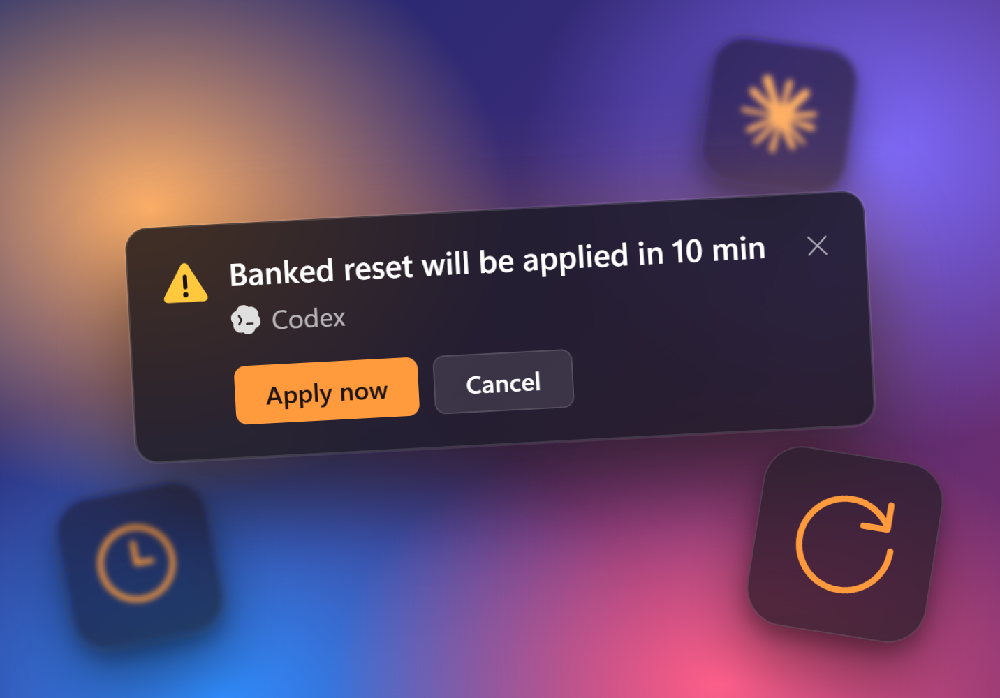

**Never lose a banked reset.** Turn on automatic resets and Minibar applies a Codex or Claude banked reset shortly before it expires, from 5 minutes to 24 hours ahead.

- Ten minutes before, a notification lets you apply the reset now or cancel it for this credit. Set it up under Settings > Limit activation, or per account in Providers.
- A reset is spent only when a limit has usage to clear. The warning shows the account's current limits.
- Middle-click a notification to close it.
- Claude, Kiro and Antigravity CLIs launched by Minibar no longer self-update in a console window that steals focus.
- Stream Deck 0.1.0.10 refreshes Minibar data every second.
