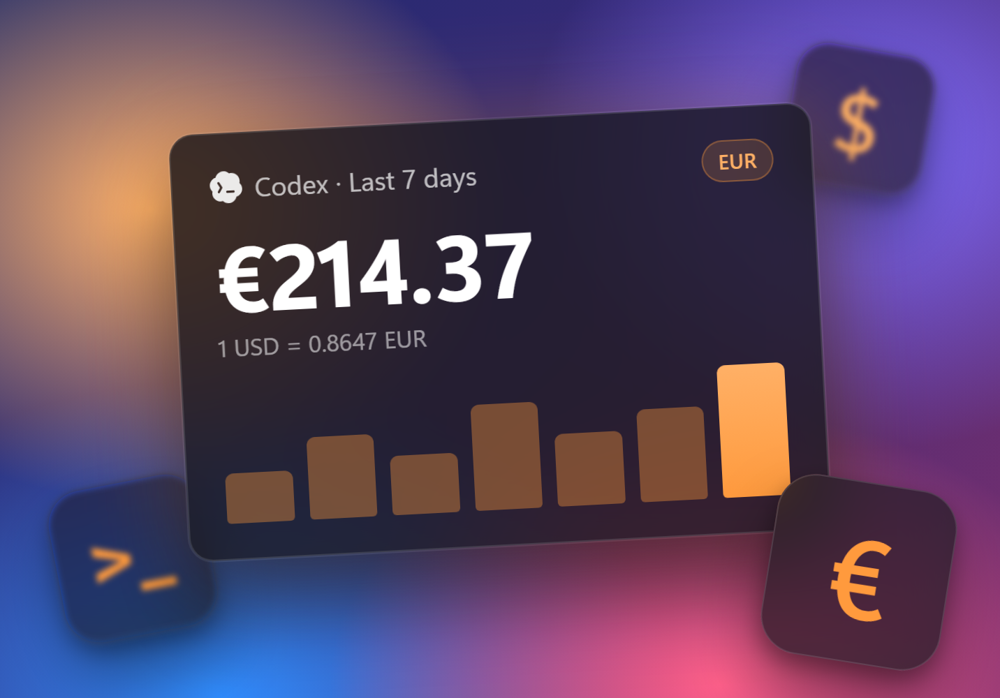

**Usage costs in your currency.** Pick a currency under Settings > General > Usage currency, and the popup, taskbar and activity chart show costs in it.

- Rates come from Exchange Rate API and keep working offline. You can set your own symbol and put it before or after the amount.
- Cursor usage loads again on Windows, now that Cursor encrypts its sign-in tokens.
- On Linux, **Update** now installs AppImage and tarball updates in place.
- New on Linux: `codex-minibar status` for Waybar, Polybar and scripts, GNOME and Plasma panel widgets, `.rpm` and AUR packages. The AppImage also starts on machines without a GPU.
