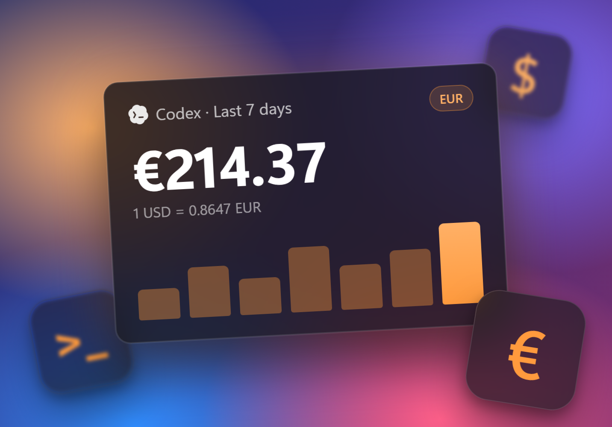

**Расходы в вашей валюте.** Выберите валюту в Настройках > Общие > Валюта расходов, и всплывающее окно, панель задач и график активности покажут расходы в ней.

- Курсы берутся из Exchange Rate API и работают без интернета. Можно задать свой символ валюты и поставить его перед суммой или после неё.
- Расходы Cursor на Windows снова загружаются после того, как Cursor начал шифровать токены входа.
- На Linux кнопка **Обновить** теперь сама устанавливает обновления AppImage и архива tar.gz.
- Новое на Linux: `codex-minibar status` для Waybar, Polybar и скриптов, виджеты панели GNOME и Plasma, пакеты `.rpm` и AUR. AppImage теперь запускается и на компьютерах без видеокарты.
