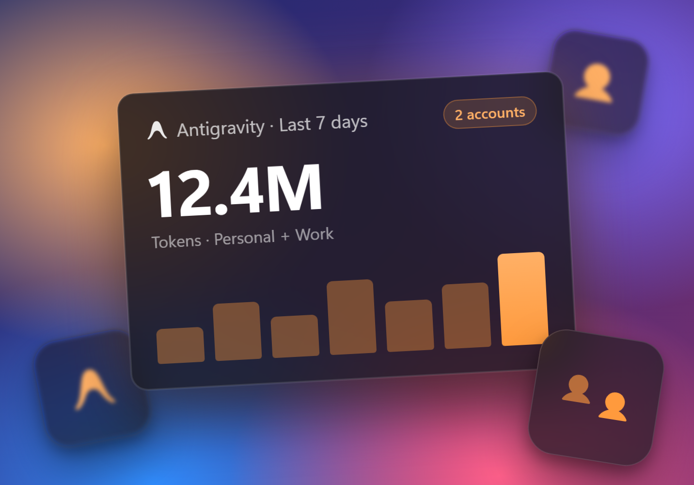

**Antigravity in Usage.** See hourly and daily activity, token counts, and a model breakdown from local conversation history.

**Multiple Google accounts.** Add an Antigravity instance per account in Settings > Providers. Link an existing T3 Code profile or sign in through agy with a separate profile folder. Each instance shows its own quotas and history.
